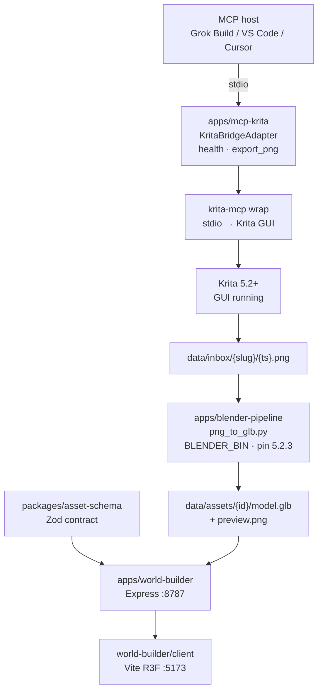

# AGENT_GUIDE — graphics-pipeline

**Audience:** any coding agent (Claude, Grok, Cursor, Copilot, etc.) and human contributors.  
**Repo:** https://github.com/DavidGrice/graphics-pipeline  
**Local root:** repository checkout (this monorepo).  
**Status:** Sprint 1 MVP + Sprint 1.5 CI. Read this before changing code or opening a PR.

**Architecture (facade, promotion, live vs demo):** [`ARCHITECTURE.md`](./ARCHITECTURE.md)

---

## 1. Elevator (one paragraph)

This npm monorepo is a **local, open-source graphics pipeline**: an MCP host talks to a **Krita** bridge (Sprint 1 wraps upstream **`krita-mcp`**) to export **PNG** scenes; **Blender** headless converts PNG → **GLB** (mesh plane + trivial Action); a **MERN** Express API stores asset **metadata** (Mongo optional) and serves files from **local disk**; a **React + react-three-fiber** client loads GLB and plays clips. **GLB** (or FBX interchange) is required for anything with skins/animation; **OBJ is static-only**. CI runs `npm run test:s1` on Ubuntu without requiring Krita/Blender installed.

---

## 2. Architecture



ASCII (same flow): see also `docs/sprint1-pipeline-diagram.md`.

```
MCP host → apps/mcp-krita facade → krita-mcp → Krita GUI
        → data/inbox/{slug}/{ts}.png
        → blender -b -P png_to_glb.py → data/assets/{id}/model.glb
        → Express (/api/assets) + R3F viewer (clips[])
```

---

## 3. Prerequisites

| Tool | Requirement |
|------|-------------|
| **Node.js** | `>=20` (`.nvmrc` = `20`) |
| **npm** | workspaces + lockfile (`npm ci`) |
| **Krita** (GUI) | Running for live MCP smoke; not required for `test:s1` |
| **krita-mcp** | `uvx krita-mcp install`; enable Tools → Scripts → MCP Bridge |
| **Blender** | Docs/CI pin **5.2.3 LTS**; scripts tolerate **≥ 4.2**; set `BLENDER_BIN` if needed |
| **MongoDB** | Optional; API falls back to in-memory if down (see `.env.example`) |

**OS:** All-OS supported; **Windows-primary** for live smoke path notes (`%APPDATA%\krita\pykrita\`, `BLENDER_BIN` to `blender.exe`). **CI = Linux** (`ubuntu-latest`).

Scaffolding and unit tests **do not** require Krita or Blender. Missing tools must fail with clear messages (not silent success).

---

## 4. Package map

| Path | npm name | Role |
|------|----------|------|
| `packages/asset-schema/` | `@graphics-pipeline/asset-schema` | Zod/TS asset contract — **authoritative with** `docs/sprint1-asset-contract.md` |
| `apps/mcp-krita/` | `@graphics-pipeline/mcp-krita` | Adapter facade: stable tools `health`, `export_png`; wraps krita-mcp |
| `apps/blender-pipeline/` | (scripts, not always a workspace package) | `png_to_glb.py`, `pipeline.sh`, `run_mvp.sh`, demo GLB fallback |
| `apps/world-builder/` | `@graphics-pipeline/world-builder` | Express API (`PORT=8787`) |
| `apps/world-builder/client/` | `@graphics-pipeline/world-builder-client` | Vite + R3F UI (`:5173`) |
| `tests/` | — | `npm run test:s1` → `tests/s1-*.test.mjs` |
| `data/inbox/`, `data/assets/` | — | Runtime only; **never commit media** (keep `.gitkeep`) |

Root workspaces (from `package.json`): `packages/*`, `apps/mcp-krita`, `apps/world-builder`, `apps/world-builder/client`.

---

## 5. How to run locally

```bash
cd graphics-pipeline
npm ci
npm run build:schema

# Required before PR
npm run typecheck
npm run test:s1

# API — http://127.0.0.1:8787
npm run dev -w @graphics-pipeline/world-builder
# or: npm run dev:world

# UI — http://127.0.0.1:5173  (second terminal)
npm run dev -w @graphics-pipeline/world-builder-client
# or: npm run dev:client
```

Copy `.env.example` → `.env` locally. **Never commit `.env`.**

### Blender (when installed)

```bash
export BLENDER_BIN=/path/to/blender   # optional if on PATH
./apps/blender-pipeline/pipeline.sh ./data/inbox/demo/in.png ./data/assets/demo/model.glb

# Windows PowerShell example
$env:BLENDER_BIN = "C:\Program Files\Blender Foundation\Blender 5.2\blender.exe"
& $env:BLENDER_BIN --background --python apps/blender-pipeline/png_to_glb.py -- in.png out.glb
```

Orchestrated MVP slice:

```bash
./apps/blender-pipeline/run_mvp.sh hero-billboard
```

If Blender is absent, `make_demo_glb.mjs` may produce a **demo-only** GLB — not a substitute for live Windows/Blender AC.

### Krita MCP

1. Start Krita GUI.  
2. `uvx krita-mcp install` — enable MCP Bridge.  
3. Point host at `apps/mcp-krita/host-config.example.json`.  
4. Export timeout **≥ 60s**.  

```bash
npm run smoke:demo -w @graphics-pipeline/mcp-krita   # path dry-run
npm run smoke -w @graphics-pipeline/mcp-krita        # needs live Krita for real export
```

---

## 6. Formats (hard rules)

| Format | Use |
|--------|-----|
| **`.glb` / glTF** | **Canonical** for skins, armatures, animation clips |
| **FBX** | Optional interchange; prefer convert to GLB for the viewer |
| **`.obj`** | **Static mesh only** — no bones, no clips. If `clips.length > 0`, OBJ must not be the playback path |

Invariants: `docs/sprint1-asset-contract.md` §3. Enforced in tests (`tests/s1-t2-format-gates.test.mjs`).

Blender MVP: **no EEVEE** in pipeline scripts — geometry + materials + `export_scene.gltf` only.

---

## 7. Branch model & CI

```
feature/* | bug/* | enhancement/*
        │ PR (CI required)
        ▼
       dev  ──PR──►  test  ──PR──►  main
```

| Rule | Detail |
|------|--------|
| Work branches | Prefix `feature/`, `bug/`, or `enhancement/` + kebab slug |
| Default PR base | **`dev` only** — **never** open topic PRs into `main` or `test` |
| Promotion | `dev` → `test` (only from `dev`) → `main` **prod** (only from `test`) |
| Default branch | **`dev`** (GitHub UI) |
| CI workflow | `.github/workflows/ci.yml` — job **`build-test`** |
| CI steps | **Promotion gate** (PR only) → `npm ci` → `build:schema` → build mcp-krita → `typecheck` → **`test:s1`** → forbid tracked media under `data/` |
| Triggers | `pull_request` + `push` to `dev`/`test`/`main`; `workflow_dispatch` |
| Token | `permissions: contents: read` |

**Dependabot (already on `main` via [#14](https://github.com/DavidGrice/graphics-pipeline/pull/14)):** weekly `npm` + `github-actions`; **`target-branch: dev`**; ignore majors; open-PR limit 3. Config: `.github/dependabot.yml`. Majors = explicit Sprint 2+ upgrade stories only.

Details: `docs/CONTRIBUTING.md`, `docs/sprint1.5-ci-branch-schematic.md`.

---

## 8. Licenses (do not invent)

| Component | License |
|-----------|---------|
| Our apps/packages/scripts | **MIT** (`LICENSE`) |
| Krita application / LibKis plugin API | **GPL-3.0** — distributed pykrita plugins must be GPL (`NOTICE`, krita.org) |
| Sprint 1 wrap of **krita-mcp** | Upstream server/plugin Python **CC0**; optional native helper **GPL** — do not rebadge under MIT |
| Future `apps/krita-plugin/` | **GPL-3.0-or-later** |
| Future stdio MCP server talking HTTP to plugin | **MIT** (separate process; no LibKis embedded) |
| Blender | GPL; our `bpy` scripts stay MIT |

Full text: `NOTICE`.

---

## 9. Privacy & security (fail closed)

**Never commit:**

- `.env`, keys (`*.pem`, `*.key`, `credentials.json`, `**/secrets/**`)
- Media under `data/inbox/**` or `data/assets/**` (except `.gitkeep`)
- Accidental `*.png` / `*.glb` / `*.fbx` / `*.obj` / `*.kra` / `*.blend` (see `.gitignore`)

CI fails if matching binaries are **tracked** under `data/`. Report vulns privately per `SECURITY.md`.

---

## 10. Definition of Done — before you open a PR

```bash
npm ci
npm run build:schema
npm run build -w @graphics-pipeline/mcp-krita
npm run typecheck
npm run test:s1
```

Checklist:

- [ ] Branch named `feature/*`, `bug/*`, or `enhancement/*` (or documented promotion PR)
- [ ] Base branch is **`dev`** for all feature/bug/enhancement work — **never `main`**. Promotion PRs only: `dev`→`test`, `test`→`main`
- [ ] `test:s1` green locally; expect CI job `build-test` green
- [ ] No secrets, `.env`, or `data/**` media in the diff
- [ ] Format rules respected (no OBJ+clips); asset contract updated if schema changed
- [ ] Docs touched if behavior/contract/CI changed (`docs/`, README pointers)
- [ ] PR template filled (`.github/PULL_REQUEST_TEMPLATE.md`)

---

## 11. Non-goals / deferred (do not implement in drive-by PRs)

| Deferred | Where tracked |
|----------|----------------|
| Full first-party Krita bridge (replace krita-mcp body) | Sprint 2 cut **B** — `docs/sprint2-cut-draft.md` |
| Rigify humanoid / Mixamo anim matrix | Sprint 3 candidate; S2-C is simple armature only |
| MEAN / Angular stack | Locked **MERN** |
| EEVEE / Cycles stills in headless MVP | Explicitly out |
| Auth, GridFS, multi-user world editing | Later |
| Committing pipeline binaries to git | Forbidden |
| Relicensing GPL Krita plugin code as MIT | Forbidden |
| Opening `feature|bug|enhancement` PRs into `main` | Forbidden — `main` is prod via `test` only |

---

## 12. Key doc paths (read when relevant)

| Path | When |
|------|------|
| `README.md` | Human quick start |
| `docs/CONTRIBUTING.md` | Branch/PR/CI |
| `docs/sprint1-asset-contract.md` | **Authoritative** Mongo/disk schema |
| `docs/sprint1-pipeline-diagram.md` | Flow diagram |
| `docs/sprint1-tester-ac.md` / `docs/sprint15-tester-ac.md` | Acceptance criteria |
| `docs/sprint1-followups-licensing-blender-api.md` | GPL bridge + Blender 4.2→5.2 API |
| `docs/sprint1.5-cicd-security-research.md` | Actions/Environments/Dependabot research |
| `docs/sprint2-cut-draft.md` | Next sprint options A/B/C |
| `apps/mcp-krita/README.md` | Bridge install |
| `apps/blender-pipeline/README.md` | `BLENDER_BIN`, pin |
| `NOTICE` / `LICENSE` / `SECURITY.md` | Legal & reporting |
| `.github/workflows/ci.yml` | Exact CI steps |
| `.env.example` | Env var names only |

---

## 13. Stable MCP tool names (do not rename casually)

| Tool | Purpose |
|------|---------|
| `health` | Krita reachable |
| `export_png` | Write `data/inbox/{slug}/{ts}.png` |

Callers use `KritaBridgeAdapter` — never bind product code to vendor-specific tool ids.

---

*Sprint 1.6 agent docs. See also `ARCHITECTURE.md`.*
