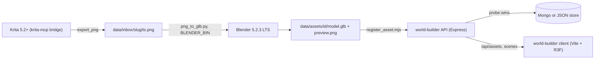
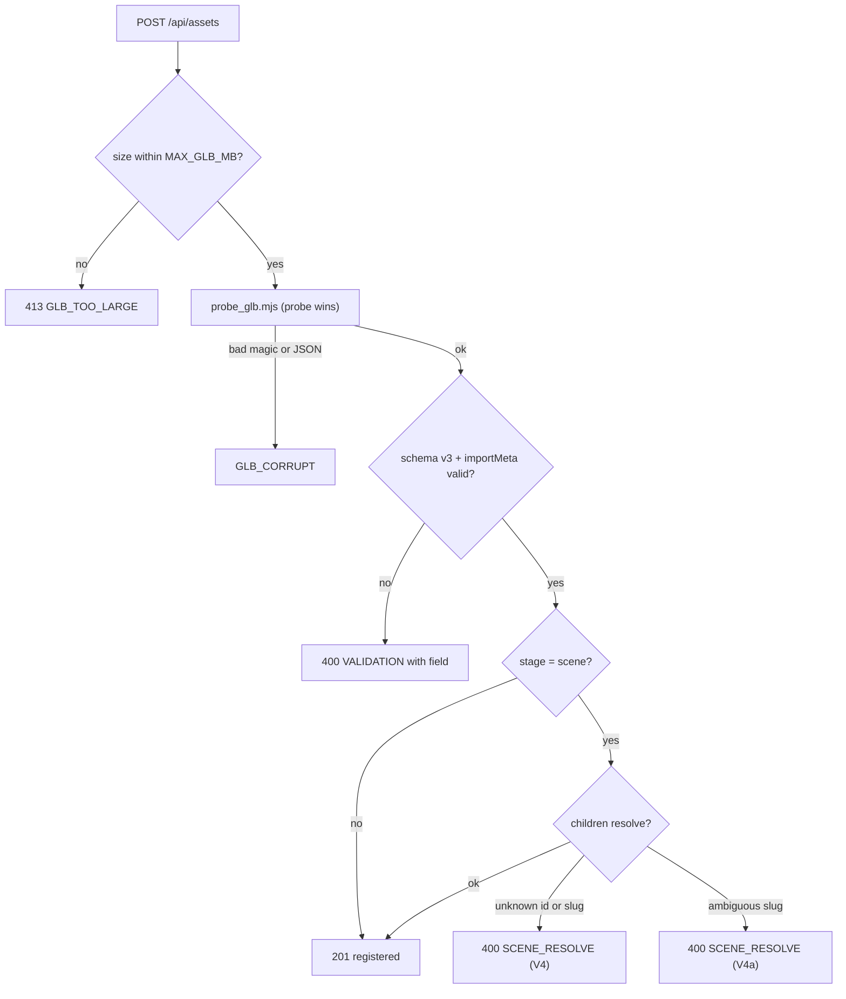

# Pipeline diagrams (S3-G E3 #150)

Source of truth for codes: [`error-codes.md`](error-codes.md). These diagrams are text only; `npm run lint:ci`
parses every `mermaid` block under `docs/` (no rendered images in git).

## Krita → Blender → register → R3F

## Register flow (probe, V4 / V4a, codes)

