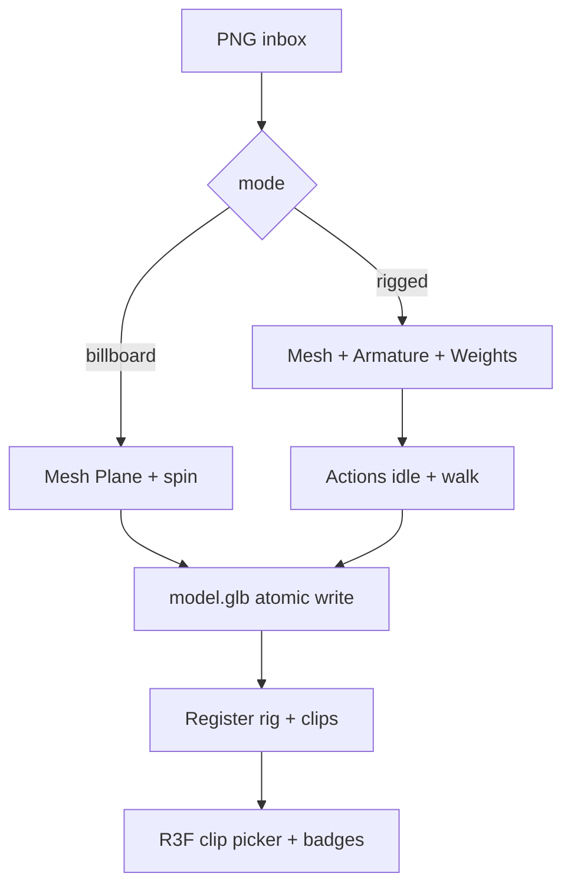

# S2-C-D2 — Pipeline schematic v2 (`billboard|rigged`)

**Role:** Graphics_Bot_Designer  
**Lane:** Design → Engineer C1/C4/C5  
**Brief:** `docs/sprint2c-brief.md` · Companion: `docs/sprint2c-d1-rig-clip-contract.md`  
**Status:** Leader-cut LOCK — S2-C-D2  
**Cut:** `/workspace/sprint2c-cut.md` · **Base:** `f748e35`

---

## 1. End-to-end

```
PNG  data/inbox/{slug}/*.png     (S1/A/B paths — BRIDGE vendor|firstparty unchanged)
         │
         ▼
png_to_glb.py  --mode billboard|rigged   (default billboard)
  BLENDER_BIN fail-closed (S2-A)
         │
         ├─ billboard → Mesh Plane → Action spin → GLB
         │
         └─ rigged → mesh (extrude|silhouette|simple)
                      → Armature + Automatic Weights
                      → Actions idle + walk (+ optional)
                      → GLB (skins + clips)
         │  atomic .tmp → rename
         ▼
data/assets/{id}/model.glb + preview.png
         │
         ▼
Register / API  stage + clips[] + rig{}   (C2)
         │
         ▼
R3F viewer  clip picker + rig badges      (C3)
```

---


## 1b. Mermaid



## 2. Smoke / env (C4)

| Item | Value |
|------|--------|
| Flag | `--mode rigged` or `SMOKE_MODE=rigged` |
| Slug example | `s2c-rigged` |
| Scripts | `smoke_live.ps1` / `run_mvp` pass mode through |
| Success | ≥2 clips play in viewer; CI unit/schema without Blender |

---

## 3. Fail-closed (C5 design notes)

| Fault | Behavior |
|-------|----------|
| `MODE=rigged` but no armature/weights | non-zero; **no** silent billboard substitute |
| Truncated / `.tmp.glb` left behind | reject register; named error |
| Missing `idle`/`walk` in rigged GLB | fail gate |
| Billboard mode | unchanged S2-A path |

Post-export Node gate (Engineer): mesh ≥1; if rigged → armature ≥1 + actions ≥2.

---

## 4. Out of D2

Rigify / Mixamo / multi-character scenes / EEVEE stills.
