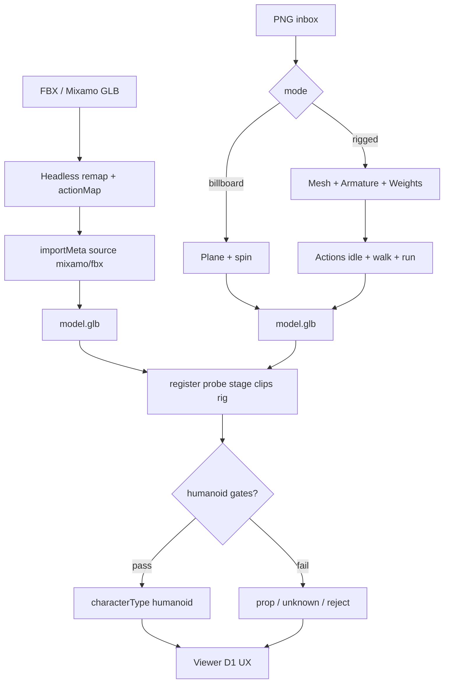

# S2-D-D2 — Mixamo import schematic + naming

**Role:** Graphics_Bot_Designer  
**Lane:** Design → Engineer E2 · Tester T1.5  
**Brief:** `/workspace/sprint2d-brief.md` (R1-bound, cut v2) · Companion: `docs/sprint2d-d1-clip-authoring-ux.md`  
**Status:** R1-bound · Leader cut v2  
**Base:** `origin/dev` @ `269d0f6` · Branch: `enhancement/s2d-docs`

---

## 1. End-to-end (ASCII)

```
PNG path (existing)                    Mixamo / FBX spike (E2)
─────────────────                      ──────────────────────
data/inbox/{slug}/*.png                local FBX|GLB (testdata/ or gitignored inbox)
        │                                       │
        ▼                                       ▼
png_to_glb --mode billboard|rigged     headless Blender remap
  → Actions idle+walk+run (rigged)       → actionMap (source → contract)
  → importMeta.source=png_pipeline       → importMeta.source=mixamo|fbx
        │                                       │
        └──────────────┬────────────────────────┘
                       ▼
                 model.glb (atomic)
                       │
                       ▼
            register_asset — PROBE WINS
              stage / clips / rig.*
              persist importMeta if present
              characterType honesty (D1 gates)
                       │
                       ▼
            R3F viewer (D1 clip UX + badges)
```

Media: **never** commit under `data/**`. Fixtures → `testdata/` or gitignored inbox. If spike blocked → `docs/...LIMITS.md` + Tester T1.5.

---

## 2. Mermaid



---

## 3. Naming / `actionMap` table

Contract names (case-sensitive): required `idle` `walk` `run` · allowlist `jump` `wave` `attack` `death` `sit` `emote_*` · billboard `spin`.

| Mixamo / source example | → Contract |
|-------------------------|------------|
| `Idle` / `Idle_A` | `idle` |
| `Walking` / `Walk` | `walk` |
| `Running` / `Run` | `run` |
| `Jump` | `jump` |
| `Wave` | `wave` |
| Unmapped / unknown | keep in probe; strip from UX list (D1) — **do not invent** required names |

```ts
importMeta?: {
  source: "mixamo" | "fbx" | "png_pipeline" | "unknown";
  originalFilename?: string;
  actionMap?: Record<string, string>; // source → contract
  boneMapStub?: string;
  characterTypeHint?: "humanoid" | "prop" | "unknown";
}
```

| Rule | Detail |
|------|--------|
| `actionMap` values | ∈ required ∪ allowlist ∪ `{spin}` else reject register |
| Remap | Explicit only — no silent rename |
| Probe | Still fills `clips`/`rig`/`stage` |
| `characterTypeHint` | Hint only; D1 gates decide; dishonest `humanoid` → **reject** |
| PNG path | `source=png_pipeline`; default `characterType=prop` for rigged |

---

## 4. Fail-closed vs dishonest humanoid

| Claim | Actual | Result |
|-------|--------|--------|
| `humanoid` | gates fail (no Mixamo/`boneMapStub`; plane prop rig) | **Reject** |
| `humanoid` | Mixamo biped + armature/weights + idle/walk | Allow |
| `prop` | Mixamo biped | Allow (conservative) |
| Missing armature/weights after import | — | non-zero; no `stage=rigged` lie |
| Missing remapped `idle`/`walk` | — | non-zero |

---

## 5. Handoffs / AC

| To | Use |
|----|-----|
| Engineer E2 | Import CLI/script + `importMeta` + probe |
| Engineer E3 | Schema gates align with §4 |
| Tester T1.5 | One imported asset or LIMITS.md path |
| D1 | Badges consume `importMeta` provenance |

| Cut AC | This doc |
|--------|----------|
| T1.4 | §4 humanoid fail-closed |
| T1.5 | §1–§3 Mixamo spike |
| T1.6 | this file |
| T1.7 | no `data/**` media |

**R1 bind:** `importMeta` / `actionMap` / humanoid provenance from `/workspace/sprint2d-brief.md` §2–§3.
