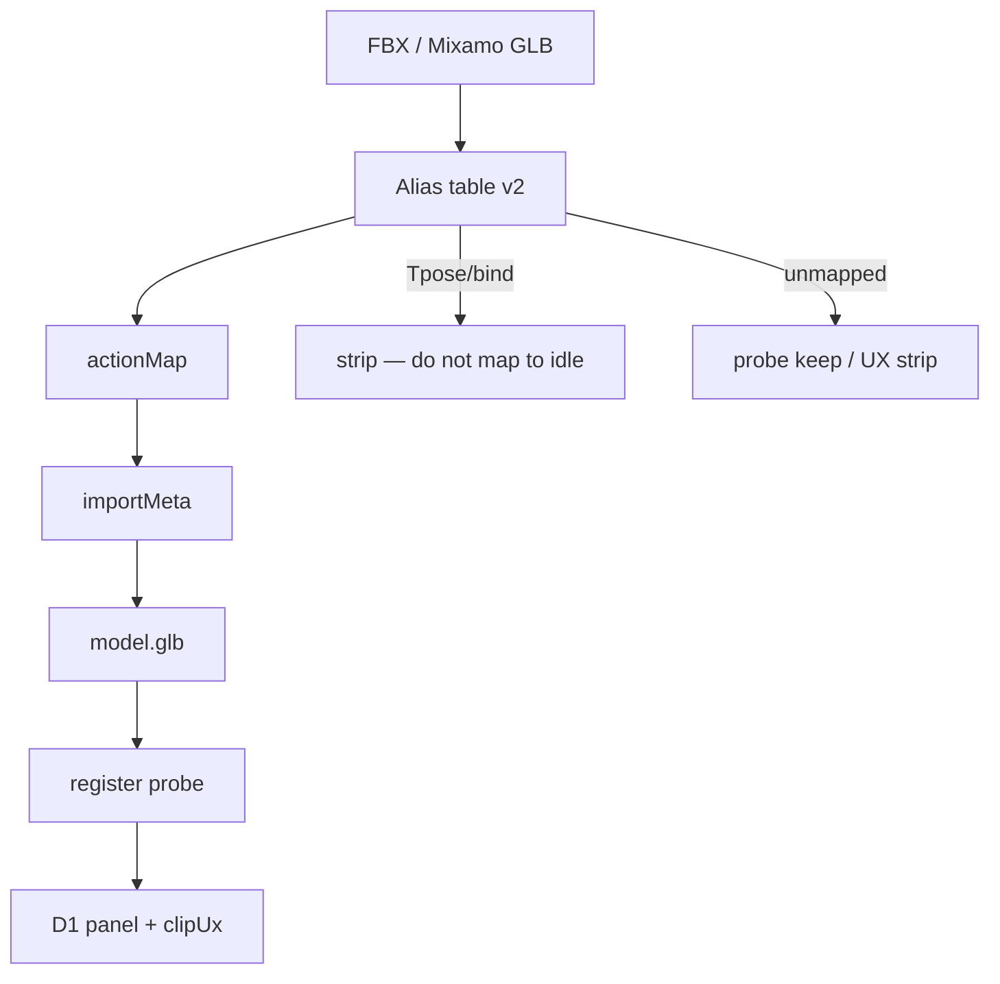

# S2-E-D2 — Mixamo alias / retarget schematic v2

**Role:** Graphics_Bot_Designer  
**Lane:** Design → Engineer E2 · Tester T1.3  
**Brief:** `/workspace/sprint2e-brief.md` · Companion: `docs/sprint2e-d1-scene-importmeta-wire.md`  
**Status:** **R1-bound** · Leader cut  
**Cut:** `/workspace/sprint2e-cut.md` · **Base:** `26eaac1`

---

## 1. Flow (v2)

```
FBX|GLB (Mixamo / compatible)
        │
        ▼
Headless remap (E2) — alias table v2
  → importMeta.source + actionMap (+ boneMapStub)
        │
        ▼
GLB → register_asset (PROBE wins)
        │
        ▼
Viewer: D1 importMeta panel + S2-D clipUx
```

Done-when (E2): LIMITS lists new aliases **or** 2nd synth/fixture recipe (gitignored `/tmp` — no licensed media in repo).

---

## 2. Mermaid



---

## 3. Alias table v2

### S2-D baseline (keep)

| Source | → Contract |
|--------|------------|
| `Idle` / `Idle_A` | `idle` |
| `Walking` / `Walk` | `walk` |
| `Running` / `Run` | `run` |

### S2-E expansion (minimum)

| Source examples | → Dest |
|-----------------|--------|
| `Jogging` / `Jog` | `run` |
| `Walk_Forward` / `walk_fwd` | `walk` |
| `Idle_Neutral` | `idle` |
| `Jump` / `Jumping` | `jump` |
| `Wave` / `Waving` | `wave` |
| `Tpose` / `T-Pose` / `bind` | **strip** (not allowlist — never map to idle) |

Optional extras (allowlist): `Attack`/`Punch`→`attack`, `Death`→`death`, `Sit`→`sit`, `Emote_*`→`emote_*`.

Rules: `actionMap` values ∈ required ∪ allowlist ∪ `{spin}` · fail-closed if remapped result missing `idle`/`walk` · `run` still required for `stage=rigged` · PNG path = `png_pipeline` (no Mixamo aliases).

---

## 4. Fail-closed

| Fault | Behavior |
|-------|----------|
| Remap claims contract name missing in GLB | reject / non-zero |
| `characterTypeHint` without S2-D gates | hint ignored; schema rejects dishonest claim |
| Licensed Mixamo blocked | LIMITS + synth fixture OK |
| Media under `data/**` | forbidden |

---

## 5. Handoffs / AC

| To | Use |
|----|-----|
| E2 | §3 aliases + LIMITS / 2nd fixture |
| D1 | actionMap chips |
| Tester T1.3 | extra alias or 2nd fixture evidence |

| Cut AC | This doc |
|--------|----------|
| T1.3 | §1–§3 |
| T1.6 | this file |
| T1.7 | no media / LIMITS honest |

**Out of scope:** full Rigify / Mixamo marketplace (Sprint 3+).
