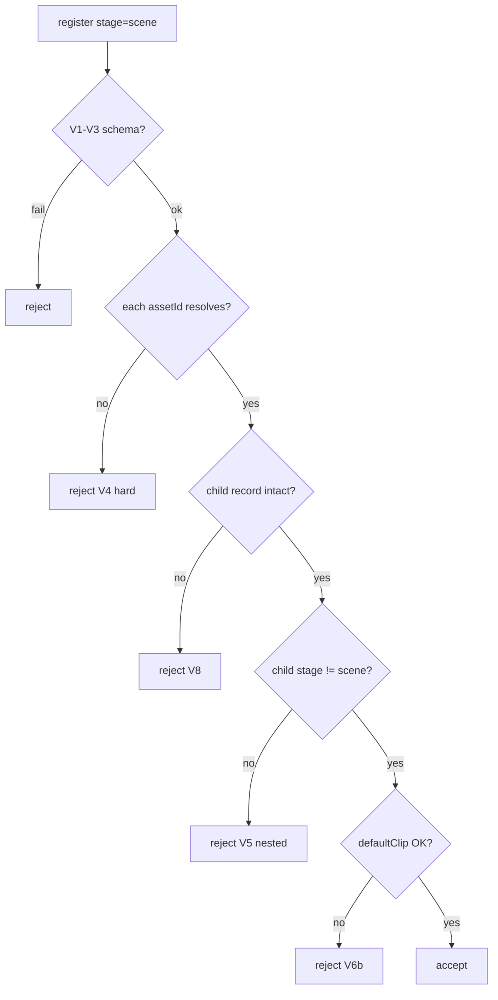

# S2-F-D2 — Resolve / reject matrix (V4 hard)

**Role:** Graphics_Bot_Designer  
**Lane:** Design → Engineer E1 · Tester T1.2/T1.5  
**Brief:** `/workspace/sprint2f-brief.md` · Companion: `docs/sprint2f-d1-scene-compose-wire.md`  
**Status:** **R1-bound** · Leader cut  
**Cut:** `/workspace/sprint2f-cut.md` · **Base:** `7d988d4`

---

## 1. Soft → hard

| S2-E | S2-F |
|------|------|
| Schema notes “API enforces assetId” | Register **must** resolve before persist |
| Missing child might 200 + broken viewer | Missing child → **fail-closed** |
| No silent strip of bad nodes | **Reject entire scene** — no partial |

```
register scene → V1–V3 → V4 resolve each assetId → V5/V6b/V8 → persist → D1 compose
```

---

## 2. Mermaid



---

## 3. Reject matrix

| Code | Condition | Behavior |
|------|-----------|----------|
| V1–V3, V7 | S2-E unchanged | reject |
| **V4** | Any `assetId` unresolved (id or unique slug) | reject — **no partial scene** |
| **V5** | Resolved child `stage === "scene"` | reject — no nested |
| **V6b** | `defaultClip` set ∧ ∉ child probed `clips[]` | reject |
| **V8** | Child stage missing / corrupt | reject (treat unresolved) |

Resolve accept: canonical UUID/id **or** unique slug→id. Error names the bad `assetId`.

### Honesty

- Do **not** auto-create placeholders.  
- Do **not** strip unknown nodes silently.  
- Scene root: `rig` false/false, `clips[]=[]`, no `characterType:humanoid` at root.

---

## 4. Allowed vs forbidden

| Allowed | Forbidden |
|---------|-----------|
| Scene of billboard + rigged (+ prop) | Scene of scenes |
| Resolve by id or unique slug | Silent drop of bad nodes |
| Per-node `defaultClip` ∈ child clips | Inventing clips / demo GLB |
| Compose transforms in viewer | Persisting viewer edits (S2-F) |

---

## 5. Handoffs / AC

| To | Use |
|----|-----|
| E1 | V4 hard (+ V5/V6b/V8) at register |
| E2 | Compose only after accept |
| Tester T1.2 / T1.5 | Unknown reject · nested reject |

| Cut AC | This doc |
|--------|----------|
| T1.2 | V4 |
| T1.5 | V5 |
| T1.6 | this file |

**Locks:** BRIDGE / OBJ / `BLENDER_BIN` / no `data/**` media.
