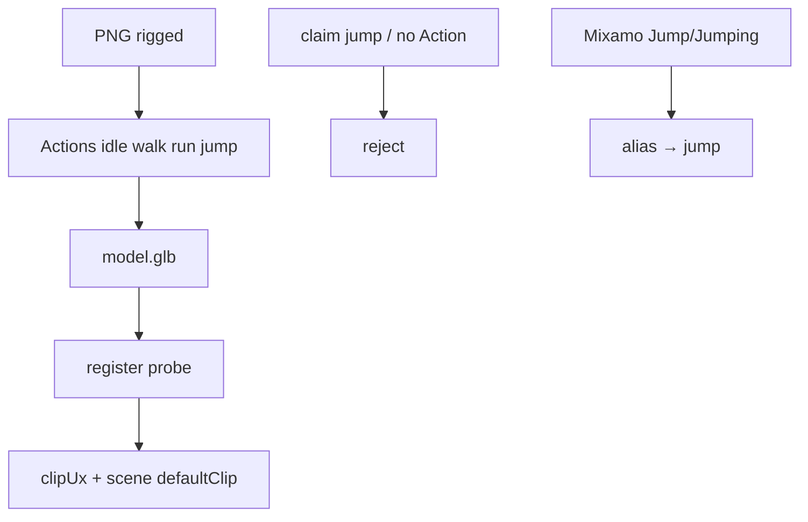

# S2-G-D2 — Jump clip + allowlist schematic

**Role:** Graphics_Bot_Designer  
**Lane:** Design → Engineer E3 · Tester T1.4  
**Brief:** `/workspace/sprint2g-brief.md` (**R1 bound**) · Companion: `docs/sprint2g-d1-scene-authoring-wire.md`  
**Status:** Bound to R1  
**Cut:** `/workspace/sprint2g-cut.md` · **Base:** `c16d72c`

---

## 1. Allowlist delta (R1 §3)

| Before (S2-D) | S2-G |
|---------------|------|
| `jump` optional allowlist | Rigged `png_to_glb --mode=rigged` **emits** Action `jump` (+ idle/walk/run) |
| Required clips | Still **idle,walk,run** hard; **`jump` recommended** on new png-pipeline exports |

| Clip | S2-G | Notes |
|------|------|-------|
| `jump` | first-class rigged export clip | LIMITS opt-out documented if skipped |
| `idle`/`walk`/`run` | unchanged required | |
| Other optionals | unchanged | `wave` `attack` `death` `sit` `emote_*` |

Billboard: still `spin` only — claiming `jump` on `mvp-billboard` → reject.

---

## 2. Schematic

```
png_to_glb --mode=rigged
    → Actions idle + walk + run + jump (+ optionals)
    → GLB probe → clips[] includes jump (unless LIMITS opt-out)
    → viewer clipUx / scene defaultClip may select jump
    → dishonest "has jump" without Action → reject (probe wins)
```



---

## 3. Honesty / gates (R1)

| Gate | Rule |
|------|------|
| Export (E3) | Actions include `idle`,`walk`,`run`,`jump` unless LIMITS opt-out |
| Register `stage=rigged` | Hard require idle+walk+run; soft warn / LIMITS if `jump` missing on **new** png-pipeline assets |
| Dishonest | `clips[]` / `clipUx` claim `jump` but Action absent → **reject** |
| `defaultClip=jump` | valid only when child clips include jump (**V6b**) |
| Mixamo | `Jump`/`Jumping` → `jump` (S2-E; keep in LIMITS) |

---

## 4. Handoffs / AC

| To | Use |
|----|-----|
| E3 | emit `jump` + schema/LIMITS/CI expect |
| D1 | defaultClip / picker includes jump when probed |
| Tester T1.4 | present when generated; dishonest reject |

| Cut AC | This doc |
|--------|----------|
| T1.4 | §1–§3 |
| T1.6 | this file |

**Out of scope:** full Rigify / nested scenes / world editor.
