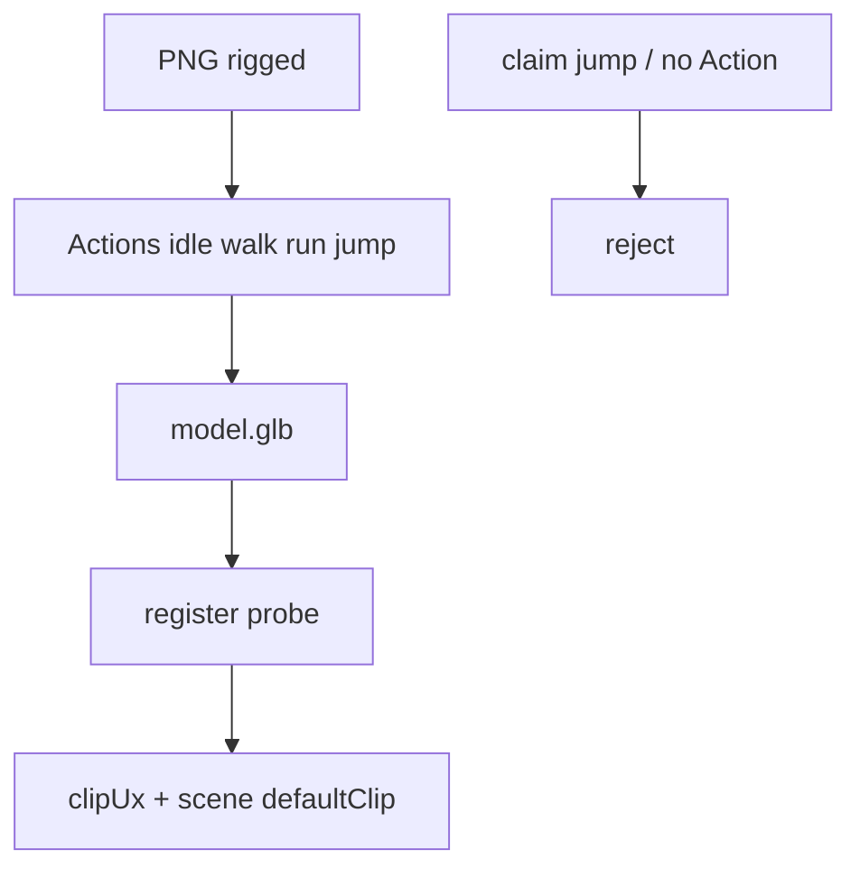

# S2-G-D2 — Jump clip + allowlist schematic

**Role:** Graphics_Bot_Designer  
**Lane:** Design → Engineer E3 · Tester T1.4  
**Brief:** `/workspace/sprint2g-brief.md` (rebind when R1 lands) · Companion: `docs/sprint2g-d1-scene-authoring-wire.md`  
**Status:** Cut-draft — **R1 pending rebind**  
**Cut:** `/workspace/sprint2g-cut.md` · **Base:** `c16d72c`

---

## 1. Allowlist delta

S2-D/E required: `idle` `walk` `run`. Optional allowlist already includes `jump`.

| Clip | S2-G | Notes |
|------|------|-------|
| `jump` | **Promote to generated optional-on-rigged** | `png_to_glb --mode=rigged` emits `jump` Action (or LIMITS opt-in skip) |
| `idle`/`walk`/`run` | unchanged required | |
| Other optionals | unchanged | `wave` `attack` `death` `sit` `emote_*` |

Billboard: still `spin` only — claiming `jump` on `mvp-billboard` → reject.

---

## 2. Schematic

```
png_to_glb --mode=rigged
    → Actions idle + walk + run + jump (+ optionals)
    → GLB probe → clips[] includes jump
    → viewer clipUx / scene defaultClip may select jump
    → dishonest "has jump" without Action → reject
```



---

## 3. Honesty

| Case | Result |
|------|--------|
| Rigged GLB missing `jump` when tip claims always-on | fail / LIMITS documented skip |
| `defaultClip=jump` but child clips lack jump | V6b reject |
| Schema/UI lists jump but GLB has none | reject dishonest claim |
| Mixamo `Jump`/`Jumping` → `jump` | keep S2-E alias |

---

## 4. Handoffs / AC

| To | Use |
|----|-----|
| E3 | emit `jump` + schema/LIMITS |
| D1 | defaultClip dropdown includes jump when probed |
| Tester T1.4 | present when generated; dishonest reject |

| Cut AC | This doc |
|--------|----------|
| T1.4 | §1–§3 |
| T1.6 | this file |

**Out of scope:** full Rigify / nested scenes / world editor.
